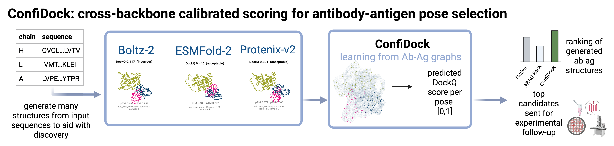

[](LICENSE)

# ConfiDock

**ConfiDock** is a lightweight GNN that predicts **DockQ** directly from a co-folded antibody–antigen structure, with no native reference needed at inference and no dependence on the co-folding model's internal representations.
Because one model scores all backbones, it can rank a decoy pool pooled across generators without per-backbone calibration, which native confidence scores cannot do.




Each complex is a residue-level graph; node and edge features combine geometry with
per-residue and pairwise confidence signals. Residues near a cross-chain partner are flagged as interface nodes. Features pass through three edge-conditioned MPNN layers, and node embeddings are pooled by a multi-head gated set-attention readout restricted to interface nodes, then regressed to a scalar in [0, 1] by an MLP with a final sigmoid.

This repository also contains the **matched fine-tuning control**; a DockQ head on Boltz-2's own confidence module, with full trunk access. The evaluation code behind the reported numbers — true-DockQ computation, per-interface metrics and ranking reports — is also included.

Decoys are generated with **Boltz-2**, **Protenix-v2** and **ESMFold2**.

> **Note on weights and data.** Neither model checkpoints nor datasets are shipped with
> this repository. SAbDab inputs, MSAs and Boltz-2 weights are placed wherever you put them; see
> [Configuration](#configuration).

--------
## Quick Start

1. **Install dependencies and set up the environment:**
   ```bash
   make init
   ```
   This will:
   - Install Python dependencies via Poetry
   - Set up pre-commit hooks
   - Install MMseqs2 for sequence analysis

   Everything needed to train and run the DockQ predictor, and to score with DockQ, is in the default install. Two parts are deliberately **not**:

   - **ESMFold2 decoy generation** needs `poetry install --with esm` on Python 3.12, and
     an `esm` distribution you can reach. The `esm` group is optional precisely so that
     the rest of the package installs without it — every `esm` import in the codebase is
     function-local.
   - **Protenix decoy generation** uses its own Poetry project in
     [`protenix-inference/`](protenix-inference/), because it needs a different Python.

   Neither is required to use ConfiDock on structures you already have.

2. **Verify MMseqs2 installation:**
   ```bash
   tools/mmseqs/bin/mmseqs version
   ```

3. **Evaluate predictions with DockQ:**

    For this part, you must have decoys and their native references: dataset assembly, model-input preparation and the grid runners for the backbones are in [`workflows/scripts/`](workflows/scripts/) with `--help` available on each.

    Do **not** substitute an off-the-shelf DockQ call. Multi-chain complexes, multiple interfaces per complex and chain-role assignment all change the computed DockQ, and those specifics are implemented in [`confidock/evaluation/`](confidock/evaluation/).

    Compute DockQ scores comparing predictions to native structures:

    **Grid mode (for multi-condition inference):**
    ```bash
    # Boltz2 grid
    poetry run python workflows/scripts/analysis/compute_dockq_scores.py \
        --model boltz \
        --grid_dir /path/to/grid/output \
        --native_dir /path/to/native/pdbs \
        --json_dir /path/to/jsons \
        --output_csv /path/to/output/dockq_scores.csv

    # Protenix grid
    poetry run python workflows/scripts/analysis/compute_dockq_scores.py \
        --model protenix \
        --grid_dir /path/to/protenix/grid \
        --native_dir /path/to/native/pdbs \
        --json_dir /path/to/jsons \
        --output_csv /path/to/output/dockq_scores.csv

    # ESMFold2 grid
    poetry run python workflows/scripts/analysis/compute_dockq_scores.py \
        --model esmfold2 \
        --grid_dir /path/to/esmfold2/grid \
        --native_dir /path/to/native/pdbs \
        --json_dir /path/to/jsons \
        --output_csv /path/to/output/dockq_scores.csv
    ```

    This generates:
    - `dockq_scores.csv`: Complex-level scores (one row per prediction, used for plotting)
    - `dockq_scores_per_interface.csv`: Detailed per-interface scores
    - Multiple plots: boxplot, violin, heatmap, diversity, etc.

    **Optional: Add diversity metrics and additional plots:**
    ```bash
    # Post-process to add diversity metrics and generate more plots
    poetry run python workflows/scripts/analysis/add_diversity_metrics.py \
        /path/to/output/dockq_scores.csv
    ```

    **Key options:**
    - `--model`: Choose `boltz` (PDB), `protenix` (CIF), or `esmfold2` (CIF)
    - `--grid_dir`: the `output_dir` from your grid-inference run
    - `--native_dir`: PDB files of ground truth entries
    - `--json_dir`: Sequence JSON files for accurate chain matching (recommended), same as above if using processed sabdab data

### DockQ predictor

Step 3 produces decoys and their true DockQ scores. Steps 4–6 train the **DockQ predictor** on the DockQ scores. The model is a GNN that scores a decoy *without* a native structure, so it can rank candidate poses at inference time. It is trained for ranking decoys **within** one native complex (picking the best pose for a target) instead of absolute DockQ accuracy.

4. **Build a training manifest from the scored predictions:**

    The predictor learns from a **manifest**: a flat CSV where one row is one decoy. Step 3's `dockq_scores.csv` files are the input, one per model source. A model source counts only when **both** its `--*-csv` and its `--*-dir` (the grid root holding the condition dirs) are given, so pass only the pairs you have — supplying a CSV without its dir silently drops that model, and dropping all three exits with `No valid model sources found`.

    ```bash
    poetry run python workflows/scripts/analysis/sample_dockq_for_training.py \
        --boltz2-csv   /path/to/boltz2/dockq_scores.csv \
        --boltz2-dir   /path/to/boltz2/grid \
        --esmfold2-csv /path/to/esmfold2/dockq_scores.csv \
        --esmfold2-dir /path/to/esmfold2/grid \
        --protenix-csv /path/to/protenix/dockq_scores.csv \
        --protenix-dir /path/to/protenix/grid \
        --stratify-antigen-clusters /path/to/mmseqs/antigen_cluster.tsv \
        --n-total 3500 \
        --output data/dockq_predictor/dockq_training_manifest.csv
    ```

5. **Train the DockQ predictor:**

    ```bash
    poetry run python workflows/scripts/training/train_simple_gnn_from_manifest.py \
        --config configs/dockq_predictor/dockq_gnn.yaml \
        --manifest data/dockq_predictor/dockq_training_manifest.csv \
        --output-dir checkpoints/dockq_gnn \
        --wandb-project confidock-dockq-predictor \
        --run-name dockq-gnn-listnet
    ```

    Every hyperparameter is in the config; the flags indicate where the data is, where checkpoints go, and whether to log to W&B, so two runs of one config are the same experiment. `configs/dockq_predictor/dockq_gnn.yaml` is a self-contained config example.

    - **`data.group_by_complex: true` is required.** The within-complex ranking term is 0 unless a batch holds ≥2 decoys of the same complex, and random batching over thousands of complexes almost never does. The loss degrades to plain Huber if this is set to false.
    - **`callbacks.monitor: val/per_native_spearman_mean`**, not `val/loss`. The objective is "given one complex's decoys, can we pick the best one".
    - **`data.graph_cache_dir`** builds each graph once and reads it back on later epochs. Point it at a **new** directory whenever a feature computation changes. Budget for it: ~2.9 MB per graph, so a 107k-row manifest is ~300 GB, and the build is CPU-bound at ~0.36 graphs/s per worker (~1.7 h at 48 workers, ~13 h at 8).
    - **`data.num_workers`** is the throughput driver, because training is **dataloader-bound, not GPU-bound**. Set it to the machine's core budget.

    A quick test of the data and model wiring can be run, without training anything:

    ```bash
    poetry run python workflows/scripts/training/train_simple_gnn_from_manifest.py \
        --config configs/dockq_predictor/dockq_gnn.yaml \
        --manifest data/dockq_predictor/dockq_training_manifest.csv \
        --fast-dev-run
    ```


6. **Score a held-out set:**

    ```bash
    poetry run python workflows/scripts/training/predict_dockq_from_manifest.py \
        --config configs/dockq_predictor/dockq_gnn.yaml \
        --checkpoint checkpoints/dockq_gnn/checkpoints/epoch027-score0.6541.ckpt \
        --manifest data/dockq_predictor/val_hard_manifest.csv \
        --output-dir results/dockq_gnn/val_hard \
        --prefix val_hard/
    ```

    Pass **the config the checkpoint was trained with**: the checkpoint holds only weights, so the architecture and the featurization settings (`interface_cutoff`, `knn_k`) are read from the config.

    Every row is scored (no splitting, no sampling), producing `predictions.csv` (the manifest rows plus a `dockq_pred` column) and `metrics.json`. Add `--no-graph-cache` for a one-off set, where caching gains nothing.

    **Reading the metrics.** `per_native_spearman_mean` pools every complex, including the near-flat ones where a Spearman over decoys that all score alike is noise around zero, so it reads far lower than the model's useful ranking ability. The scoring summary therefore also prints the **DockQ-std breakdown**, where the high-variance bin is the regime of interest:

    ```
      DockQ-std bin   n_cplx  n_decoys  per-native rho   global rho
      0.00_0.02          113      5058         -0.0320       0.1189
      ...
      0.20_1.01          230     10314          0.5845       0.7216
      std_ratio                            0.5780
    ```

7. **Score new predicted structures with the trained model:**

    Steps 4–6 train and validate the predictor. To *use* it for inference (with no native to compare against), use `workflows/scripts/inference/predict_dockq.py`, which needs no ground-truth labels and returns a rank per pose within each complex:

    ```bash
    poetry run python workflows/scripts/inference/predict_dockq.py \
        --checkpoint  "$MODEL_DIR/epoch034-score0.6579.ckpt" \
        --config      "$MODEL_DIR/config_used.yaml" \
        --structures '/data/poses/7y8j_HLA_*.pdb' \
        --model-source boltz2 --chains HLA \
        --output results/scores.csv
    ```

    For more details see: [Scoring predicted structures with the DockQ predictor](docs/dockq_predictor_inference.md).


### Boltz-2 confidence fine-tune (the matched control)

This section is the fine-tuning **control**. Does the interface-aware graph of steps 4–6 capture ranking signal that a scalar confidence head cannot, *even when that head has full access to the co-folding model's trunk*?

Step 3 gives decoys with true DockQ labels. There are two ways to score a decoy *without* a native: train a GNN over the structure (steps 4–6), or re-use the confidence module Boltz-2 already has. This section is the second one. The 481.5M-parameter trunk is frozen and its outputs are cached once per entry; what trains is Boltz-2's 25.0M-parameter `confidence_module` plus a new 0.20M-parameter `DockQHead` that predicts DockQ from the confidence latents.

Before starting you need: labelled decoys and their `dockq_scores.csv` files from step 3, a manifest CSV per dataset (step 4), the Boltz-2 weights and CCD (the `boltz-cache` under `/data`), and **~160 GiB of volume** for the trunk cache.

For more details, see: [`docs/boltz_confidence_caching.md`](docs/boltz_confidence_caching.md) for the caching pipeline.


8. **Cache the trunk once per entry:**

    ```bash
    # Single GPU
    poetry run python workflows/scripts/inference/cache_boltz2_confidence.py \
        --root       /path/to/sabdab_train \
        --output_dir /path/to/volume/sabdab_train/confidence_cache \
        --boltz_cache /path/to/boltz-cache

    # All GPUs, one shard per GPU, restarting any shard that dies
    workflows/scripts/inference/cache_boltz2_confidence_auto_restart.sh \
        /path/to/volume/sabdab_train/confidence_cache

    # A validation set: its directory layout differs and it has no perturbed decoys, so use the manifest
    workflows/scripts/inference/cache_boltz2_confidence_auto_restart.sh \
        /path/to/volume/sabdab_val_easy/confidence_cache \
        0,1,2,3,4,5 \
        --root /path/to/sabdab_val_easy \
        --manifest_csv data/dockq_predictor/val_easy_manifest.csv
    ```

    The trunk never sees coordinates, so `s`/`z` are identical for every decoy and the full `model.forward` only needs to run once. The confidence head runs with `skip_run_structure=True` so it scores *the decoy supplied*, keeping each cached record in 1:1 correspondence with its DockQ label.


9. **Backfill the DockQ sub-scores into the cache:**

    ```bash
    # --dry_run first: it reports the match rate and the DockQ agreement
    # without touching a byte
    poetry run python workflows/scripts/data/backfill_dockq_components.py \
        --cache_dir  /path/to/volume/sabdab_train/confidence_cache \
        --manifest   data/dockq_predictor/dockq_training_manifest.csv \
        --latent_dir /path/to/volume/sabdab_train/dockq_latents \
        --dry_run
    ```

    **This is not optional for the composite head.** A cache built by walking the dataset root records only `dockq`, but the head predicts all three DockQ sub-scores, and `EntryGroupedCacheDataset` *drops* every decoy whose `fnat`/`irmsd`/`lrmsd` are missing (counted as `n_dropped_components`). Supervising the three sub-scores *directly* is a separate, optional choice controlled by `--lambda_component`: at `0.0` they are supervised only through the DockQ mean they feed, and the backfill is still required either way. Pass `--manifest` more than once when several manifests cover one dataset.

10. **Optional but cheap first: the frozen-latent probe.**

    With the confidence module frozen and in `eval()`, the pooled latents are a deterministic function of `(entry, decoy)`, so they can be extracted once and reused. An epoch then costs seconds against a ~300 MiB table, instead of the ~13.5 h it takes through the full fine-tuning module.

    ```bash
    # Extract, one shard per GPU (~15 min on 6 A100 GPUs; resumable like the cache)
    workflows/scripts/training/extract_dockq_latents_all_gpus.sh \
        /path/to/volume/sabdab_train/dockq_latents

    # Train the head on the latents
    poetry run python workflows/scripts/training/train_dockq_probe.py \
        --latent_dir      /path/to/volume/sabdab_train/dockq_latents \
        --eval_latent_dir /path/to/volume/sabdab_val_easy/dockq_latents \
        --output_dir runs/dockq_probe_v1 --epochs 40
    ```


11. **Fine-tune the confidence module + DockQ head:**

    ```bash
    # Smoke test first — one GPU, 20 batches, ~15 min
    workflows/scripts/training/finetune_confidence_ddp.sh runs/ft_smoke 1 \
        --cache_dir /path/to/volume/sabdab_train/confidence_cache \
        --max_entries 40 --limit_train_batches 20 --limit_val_batches 10 \
        --epochs 1 --no_wandb

    # The real run: one process per GPU
    workflows/scripts/training/finetune_confidence_ddp.sh runs/confidence_ft_listnet 6 \
        --cache_dir          /path/to/volume/sabdab_train/confidence_cache \
        --external_cache_dir /path/to/volume/sabdab_val_easy/confidence_cache \
        --epochs 5 \
        --lr 1e-3 --confidence_lr 1e-5 \
        --rank_type listnet --rank_tau 0.10 --lambda_rank 0.2 \
        --lambda_component 0.0 --huber_delta 0.1 \
        --wandb_run_name confidence_ft_listnet
    ```

    The wrapper is `torchrun --nproc_per_node=<NPROC>` plus `nice`; gradients are averaged by hand after backward.


12. **Score a finished checkpoint on another held-out set:**

    ```bash
    poetry run torchrun --nproc_per_node=2 \
        workflows/scripts/training/finetune_confidence_ddp.py \
        --epochs 0 \
        --ft_checkpoint      runs/confidence_ft_listnet/confidence_ft_best.pt \
        --cache_dir          /path/to/volume/sabdab_train/confidence_cache \
        --external_cache_dir /path/to/volume/sabdab_val_hard/confidence_cache \
        --hidden 256 --dropout 0.1 --val_fraction 0.1 --split_seed 0 \
        --output_dir runs/confidence_ft_listnet_valhard
    ```

    `--epochs 0` with `--ft_checkpoint` loads the weights and goes to the OOD pass (one forward over 306 entries / 13,655 decoys took ~30 min on 2 A100 GPUs).
    Five arguments must match the training run: `--hidden`/`--dropout` or the state dict fails to load, and the same `--cache_dir`/`--val_fraction`/`--split_seed` so the split is reproduced.

    **Reading the report.** Every table has `dockq_pred` alongside all nine Boltz-2 confidence metrics computed on exactly the same rows, plus `ORACLE`. Read `per_entry_rankable` (natives whose true-DockQ spread is at least `RANKABLE_MIN_STD = 0.05`) and the per-std-bin breakdown, not `per_entry`: on `val_easy` a third of natives have a near-flat DockQ profile, so ranking them measures noise. From `runs/confidence_ft_listnet` on `val_easy` (33,879 decoys / 763 natives):

    ```
      metric              global   per_entry   per_entry_rankable
      dockq_pred          0.6118      0.1411               0.2503
      confidence_score    0.6145      0.0959               0.1887
      complex_plddt       0.5439      0.0858               0.1770
      iptm                0.5332      0.0074               0.0460
    ```

    So the fine-tuned head out-ranks Boltz-2's own metrics *within* a native while matching them globally (and still trails the ListNet GNN of steps 4–6).

    To put both models in one table, computed by one code path:

    ```bash
    poetry run python workflows/scripts/analysis/compare_ft_vs_gnn.py
    ```

    Its run locations are hard-coded at the top of the file (`SETS`, `GNN_RUNS`); edit them for your runs. Make sure to compare against the **ListNet** GNN, whose ranking objective matches the fine-tune's, and keep the scope **pooled** — one Spearman per native over all decoys from all folding models. A native confidence metric only ever ranks within its own model, so a per-model native number is a different, harder task and is not comparable to these.


--------
## Configuration

Paths that depend on where ConfiDock is deployed are read from the environment and are not hardcoded in a module (see [`confidock/paths.py`](confidock/paths.py)):

| Variable | Meaning | Default |
|---|---|---|
| `CONFIDOCK_BOLTZ_CACHE` | Boltz-2 weights and CCD files | `$XDG_CACHE_HOME/boltz` (`~/.cache/boltz`) |
| `CONFIDOCK_SABDAB_JSON_DIR` | `os.pathsep`-separated dirs of SAbDab sidecar JSONs (chain typing, CDR labels) | unset — no CDR metadata |

Every path shown as `/data/...` in the examples above is a placeholder for your own storage layout. Training and inference scripts also accept these as explicit flags, which override the environment.

Weights & Biases logging is optional and off unless a project is given. Credentials are read from `WANDB_API_KEY` in the environment, or from a gitignored `wandb_env` file at the repository root; `--no_wandb` disables tracking outright.

--------
## Project organisation

```
confidock/                 Library.
  boltz/                     Boltz-2 confidence fine-tuning, inference and caching.
  dockq_predictor/           Standalone DockQ-predictor GNN (data, models, losses, training).
  esmfold2/, protenix/       Co-folding backend wrappers.
  evaluation/                DockQ, metrics, bias, diversity, epitope and sequence analysis.
  paths.py, msa.py, rcsb.py, plot.py
workflows/scripts/         Pipeline entry points.
  processing/                Dataset building and model-input preparation.
  inference/                 Grid runners, confidence caching, DockQ scoring.
  training/                  Fine-tuning, latent extraction, probes.
  analysis/                  True-DockQ computation, correlations, model comparison.
  data/                      In-place cache maintenance (DockQ sub-score backfill).
configs/                   Hydra/YAML configs for grids and training.
protenix-inference/        Separate Poetry project for Protenix (needs its own Python).
docs/                      Method and results documentation.
tests/                     CPU-only test suite; no weights, no network.
data/, models/             Empty by design; git-ignored contents.
```

--------
## Utilities

| Command | Effect |
|---|---|
| `make init` | Create the Poetry environment, install pre-commit hooks, install MMseqs2 into `tools/mmseqs/`. |
| `make install-mmseqs` | Install MMseqs2 only. Add it with `export PATH="$PWD/tools/mmseqs/bin:$PATH"` or pass `--mmseqs_bin tools/mmseqs/bin/mmseqs`. |
| `make clean` | Remove `__pycache__` and `.pyc`/`.pyo` files. |

## Testing

```bash
poetry install
poetry run pytest -m "not slow"
```

The suite runs on CPU with no network access and no model weights. Tests that need a real checkpoint are marked `slow` and excluded above.

## Contributing

See [CONTRIBUTING.md](CONTRIBUTING.md). Contributors are listed in [AUTHORS.md](AUTHORS.md).

## License

Apache-2.0. See [LICENSE](LICENSE).
